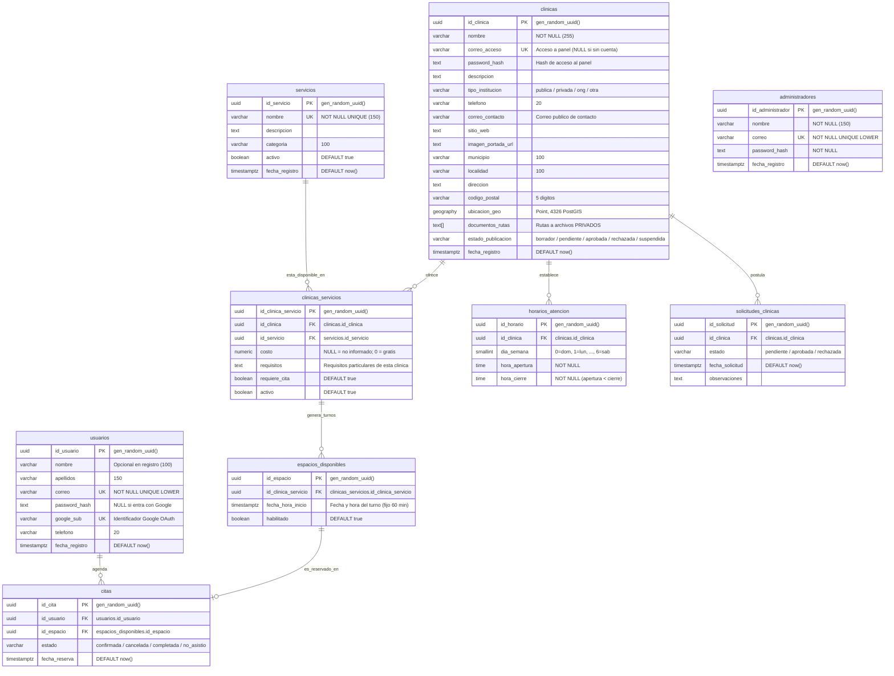

# PuntOax — Modelo de Datos v1.3, Migraciones y Guía de Autenticación/Autorización

**Kelly y Jonathan**.

---

## 1. Matriz de Roles y Control de Acceso (RBAC)

De acuerdo con las definiciones de alcance del equipo de PuntOax, se establece una **matriz estricta de 4 roles**. No existen roles fuera de esta matriz confirmada:

| Rol | Entidad BD | Autenticación | Alcance y Permisos Principales |
| :--- | :--- | :--- | :--- |
| **1. Público / Visitante** | Ninguna (Sin cuenta) | Sin autenticación | • Consulta pública de clínicas con `estado_publicacion = 'aprobada'`.<br>• Búsqueda por municipio, localidad y proximidad geográfica PostGIS.<br>• Consulta del catálogo general de servicios y requisitos públicos.<br>• Visualización de horarios y disponibilidad de turnos. |
| **2. Usuario / Paciente** | `usuarios` | Email + Password Hash **o** Google OAuth (`google_sub`) | • Registro individual e inicio de sesión.<br>• Consulta de sus propios datos de perfil.<br>• Reserva de turnos disponibles (`citas`).<br>• Visualización y cancelación de sus propias citas programadas. |
| **3. Clínica / Sede** | `clinicas` | `correo_acceso` + `password_hash` | • Acceso institucional al panel de la clínica.<br>• Gestión de datos de la sede (teléfono, contacto, dirección, horarios).<br>• Postulación y subida de rutas de documentos privados (`documentos_rutas`).<br>• Configuración de servicios propios ofertados (`clinicas_servicios`).<br>• Habilitación o bloqueo de turnos de atención (`espacios_disponibles`).<br>• Consulta del listado de citas agendadas en sus servicios. |
| **4. Administrador** | `administradores` | `correo` + `password_hash` | • Superadministración central del sistema PuntOax.<br>• Gestión del catálogo maestro de servicios (`servicios`).<br>• Revisión y dictamen de postulaciones (`solicitudes_clinicas`).<br>• Aprobación, suspensión o rechazo de clínicas (`estado_publicacion`).<br>• Supervisión global de estadísticas y operación. |

> **Decisión de diseño clave sobre clínicas:**  
> Cada registro en la tabla `clinicas` representa una sede física y, simultáneamente, su propia cuenta de acceso al panel institucional mediante `correo_acceso` y `password_hash`. **No existe tabla intermedia `usuarios_clinicas`**, eliminando complejidad innecesaria. Si una clínica fue dada de alta por el administrador sin acceso web, sus campos `correo_acceso` y `password_hash` permanecen en `NULL`.

---

## 2. Diagrama de Entidad-Relación (ERD)



---

## 3. Diccionario de Datos y Reglas de Negocio

### 3.1. `usuarios`
- **Propósito:** Registro y autenticación de ciudadanos que solicitan y agendan citas médicas.
- **Reglas de Integridad:**
  - `correo`: `UNIQUE`, normalizado en minúsculas mediante índice `LOWER(TRIM(correo))`. Expresión regular para validación de formato estándar RFC.
  - `password_hash` y `google_sub`: Restricción `CHECK (password_hash IS NOT NULL OR google_sub IS NOT NULL)`. Permite tanto registro con credenciales tradicionales como federación con Google OAuth.
  - `password_hash`: Restricción `CHECK (password_hash IS NULL OR LENGTH(password_hash) >= 50)`. Evita que por error se persistan contraseñas en texto plano.

### 3.2. `clinicas`
- **Propósito:** Representación física y cuenta de acceso institucional de centros de salud, hospitales y ONGs.
- **Reglas de Integridad:**
  - `correo_acceso`: Único e independiente de `correo_contacto`. El correo de acceso es para autenticarse al panel; el de contacto se exhibe al público.
  - `chk_clinicas_cuenta_panel`: `CHECK ((correo_acceso IS NULL AND password_hash IS NULL) OR (correo_acceso IS NOT NULL AND password_hash IS NOT NULL))`. Garantiza coherencia: si hay cuenta de panel, ambos campos deben existir.
  - `ubicacion_geo`: Tipo `GEOGRAPHY(Point, 4326)` con índice espacial `GIST`. Permite cálculo de distancias reales en metros sobre el esferoide terrestre WGS84.
  - `documentos_rutas`: Arreglo `text[]` que almacena identificadores o rutas de almacenamiento privado seguro (ej. `/storage/privado/licencias/...`), nunca URLs públicas.
  - `estado_publicacion`: Valores restringidos: `'borrador'`, `'pendiente'`, `'aprobada'`, `'rechazada'`, `'suspendida'`.

### 3.3. `administradores`
- **Propósito:** Cuentas de personal del equipo central de PuntOax para supervisión, aprobación de clínicas y catálogo maestro.
- **Reglas de Integridad:**
  - `password_hash`: `NOT NULL` con longitud mayor o igual a 50 caracteres (hashes bcrypt).

### 3.4. `servicios` y `clinicas_servicios`
- **Propósito:** `servicios` es el catálogo normalizado de intervenciones de salud (ej. ILE, ITS, Papanicolaou). `clinicas_servicios` define qué clínica provee qué servicio, bajo qué costo (`0.00` = gratuito, `NULL` = no informado) y con qué requisitos particulares.
- **Reglas de Integridad:**
  - `uq_clinicas_servicios_par`: `UNIQUE (id_clinica, id_servicio)`.
  - `chk_clinicas_servicios_costo`: `costo IS NULL OR costo >= 0`.

### 3.5. `horarios_atencion`
- **Propósito:** Franjas de atención semanal por clínica.
- **Reglas de Integridad:**
  - `dia_semana`: `0` = Domingo, `1` = Lunes, ..., `6` = Sábado.
  - `hora_apertura < hora_cierre`.
  - `UNIQUE (id_clinica, dia_semana, hora_apertura, hora_cierre)`: Permite múltiples intervalos no duplicados en un mismo día (ej. turno matutino 08:00–14:00 y vespertino 16:00–20:00).

### 3.6. `espacios_disponibles` y `citas` (Regla Crítica de Agendamiento)
- **Propósito:** Los turnos tienen una duración fija de 60 minutos por servicio. Dos servicios diferentes en una misma clínica pueden tener turno a la misma hora (ej. consultorio 1: ITS a las 10:00; consultorio 2: ILE a las 10:00).
- **Índice Único Parcial:**
  ```sql
  CREATE UNIQUE INDEX uq_citas_espacio_activa 
  ON citas (id_espacio) 
  WHERE estado <> 'cancelada';
  ```
  **Beneficio:** Previene colisiones y dobles reservas a nivel de base de datos de forma atómica. Si una cita pasa al estado `'cancelada'`, el espacio queda inmediatamente libre para ser reservado por otro usuario sin necesidad de borrar registros históricos.

---

## 4. Guía de Integración para Kelly y Jonathan (API)

El módulo utilitario listo para usar se encuentra en [`backend/auth.js`](file:///c:/Users/Ivan/puntoax/backend/auth.js).

### 4.1. Estructura del Token JWT
Al iniciar sesión exitosamente en cualquiera de los tres roles autenticados, se emite un JWT firmado con `HS256`:

```json
{
  "id": "c1f77d8a-8d1a-4c42-8378-0cf2e2646ec5",
  "correo": "usuario@ejemplo.com",
  "rol": "usuario",
  "iat": 1774000000,
  "exp": 1774604800
}
```

Valores permitidos para `rol`: `'usuario'`, `'clinica'`, `'administrador'`.

### 4.2. Registro de Usuario (`POST /api/auth/registro-usuario`)
```javascript
const { hashearPassword, generarToken } = require("./auth");
const pool = require("./db");

app.post("/api/auth/registro-usuario", async (req, res) => {
  // Registro progresivo: solo correo y password son requeridos inicialmente.
  // Nombre, apellidos y teléfono se capturan al momento de agendar cita o en perfil.
  const { correo, password, nombre = null, apellidos = null, telefono = null } = req.body;

  try {
    // 1. Validaciones básicas
    if (!correo || !password) {
      return res.status(400).json({ error: "Correo y contraseña son obligatorios." });
    }

    // 2. Generar hash seguro (coste 10)
    const hash = await hashearPassword(password);

    // 3. Inserción con correo en minúsculas (nombre opcional al registrarse)
    const { rows } = await pool.query(
      `INSERT INTO usuarios (nombre, apellidos, correo, password_hash, telefono)
       VALUES ($1, $2, LOWER(TRIM($3)), $4, $5)
       RETURNING id_usuario, nombre, apellidos, correo, telefono, fecha_registro`,
      [nombre, apellidos, correo, hash, telefono]
    );

    const nuevoUsuario = rows[0];

    // 4. Emitir JWT
    const token = generarToken({
      id: nuevoUsuario.id_usuario,
      correo: nuevoUsuario.correo,
      rol: "usuario",
    });

    res.status(201).json({ usuario: nuevoUsuario, token });
  } catch (error) {
    if (error.code === "23505") { // Código PostgreSQL para unique_violation
      return res.status(409).json({ error: "El correo ya se encuentra registrado." });
    }
    res.status(500).json({ error: "Error interno al registrar usuario." });
  }
});
```

### 4.3. Inicio de Sesión Multi-Rol
Kelly y Jonathan pueden implementar rutas separadas o unificadas:
- `POST /api/auth/login-usuario` consulta `usuarios WHERE correo = LOWER(TRIM($1))`
- `POST /api/auth/login-clinica` consulta `clinicas WHERE correo_acceso = LOWER(TRIM($1))`
- `POST /api/auth/login-admin` consulta `administradores WHERE correo = LOWER(TRIM($1))`

Ejemplo de verificación de credenciales:
```javascript
const { verificarPassword, generarToken } = require("./auth");

// Consulta del usuario y su hash
const { rows } = await pool.query(
  "SELECT id_usuario, correo, password_hash, nombre FROM usuarios WHERE correo = LOWER(TRIM($1))",
  [correo]
);

if (rows.length === 0) {
  return res.status(401).json({ error: "Credenciales inválidas." });
}

const usuario = rows[0];
const valido = await verificarPassword(password, usuario.password_hash);
if (!valido) {
  return res.status(401).json({ error: "Credenciales inválidas." });
}

// Generar token y responder
const token = generarToken({ id: usuario.id_usuario, correo: usuario.correo, rol: "usuario" });
res.json({ token, usuario: { id: usuario.id_usuario, nombre: usuario.nombre, correo: usuario.correo } });
```

### 4.4. Protección de Rutas con Middlewares
```javascript
const { autenticarToken, requerirRol } = require("./auth");

// Ruta solo para pacientes autenticados
app.post("/api/citas", autenticarToken, requerirRol(["usuario"]), async (req, res) => {
  const idUsuario = req.usuario.id;
  // req.usuario.rol === 'usuario'
});

// Ruta para clínicas o administradores
app.get("/api/clinicas/mi-panel", autenticarToken, requerirRol(["clinica"]), async (req, res) => {
  const idClinica = req.usuario.id;
  // Consulta de la agenda de la clínica
});

// Ruta exclusiva de administración central
app.patch("/api/solicitudes/:id/dictamen", autenticarToken, requerirRol(["administrador"]), async (req, res) => {
  // Aprobación o rechazo de postulaciones
});
```

---

## 5. Procedimiento de Migraciones y Reversión (Rollback)

Las migraciones se encuentran organizadas en `db/migrations/`:
- `001_create_schema_puntoax_v1_3.up.sql` / `001_create_schema_puntoax_v1_3.down.sql`
- `002_seed_initial_data.up.sql` / `002_seed_initial_data.down.sql`

El estado de cada migración se guarda automáticamente en la tabla `schema_migrations`.

### 5.1. Comandos NPM (Recomendado)
Desde la carpeta `backend`:

```bash
# 1. Aplicar todas las migraciones pendientes
npm run migrate

# 2. Revertir la última migración aplicada (Rollback)
npm run migrate:down

# 3. Ver el estado actual de las migraciones (aplicadas vs pendientes)
npm run migrate:status

# 4. Reiniciar toda la base de datos (Rollback completo + Up)
npm run migrate:reset
```

### 5.2. Ejecución con Docker Compose
Si se trabaja con Docker, `docker-compose up -d db` ejecuta automáticamente [`db/init.sql`](file:///c:/Users/Ivan/puntoax/db/init.sql) al inicializar el contenedor de PostGIS por primera vez.

Para aplicar migraciones manualmente dentro del contenedor:
```bash
docker exec -i puntoax_db psql -U postgres -d puntoax_bd < db/migrations/001_create_schema_puntoax_v1_3.up.sql
docker exec -i puntoax_db psql -U postgres -d puntoax_bd < db/migrations/002_seed_initial_data.up.sql
```

Para revertir mediante `psql`:
```bash
docker exec -i puntoax_db psql -U postgres -d puntoax_bd < db/migrations/002_seed_initial_data.down.sql
docker exec -i puntoax_db psql -U postgres -d puntoax_bd < db/migrations/001_create_schema_puntoax_v1_3.down.sql
```

---

## 6. Credenciales y Datos Semilla para Desarrollo

Las siguientes credenciales fueron generadas con hash Bcrypt (`cost = 10`) y están listas para pruebas locales y en el API:

| Rol | Correo / Acceso | Contraseña en Texto Plano | Hash Almacenado en BD |
| :--- | :--- | :--- | :--- |
| **Administrador** | `admin@puntoax.oaxaca.gob.mx` | `AdminPuntOax2026!` | `$2b$10$wbfkEGy.XL9ytb3G6.ty9OF47mNSX6qAZ6pUuhkjKslap7j7IbCxG` |
| **Clínica (Valdivieso)** | `valdivieso@salud.oaxaca.gob.mx` | `Valdivieso2026!` | `$2b$10$FbTKm1bdMGYV0eBhWgAaXe3pcBHkcSwnTd1.E3lrKnsYqwNty87Bu` |
| **Usuario (María)** | `maria.gonzalez@example.com` | `UsuarioDemo2026!` | `$2b$10$v31zR66IAloV/9la8leKF.xn37WwL9Ld9dptC4wTdVdJg5XTVCjZG` |
| **Usuario (Carlos)** | `carlos.ramirez@example.com` | *(Autenticado con Google)* | `google_sub = google_sub_oauth2_1048291048201` |
