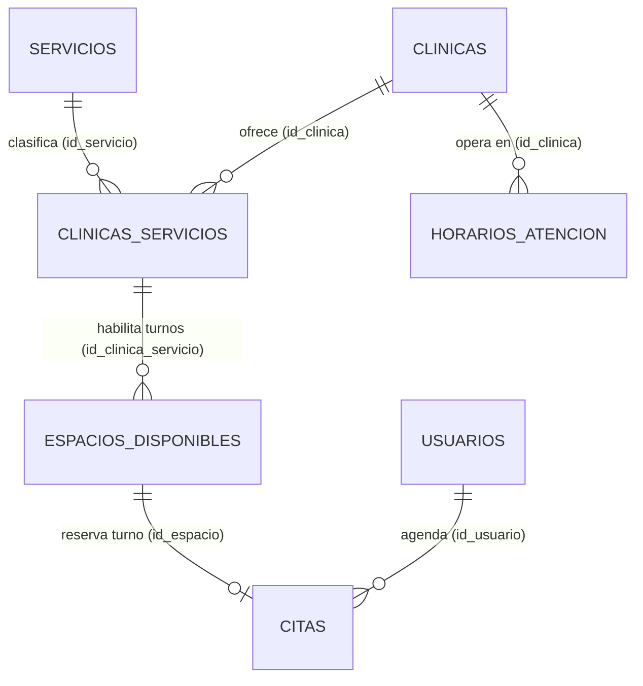

# Acuerdo Técnico: Modelo de Datos y Relaciones de Citas (Sprint 6)

**Fecha:** 9 de noviembre de 2026  
**Responsable:** Iván (Modelo de Datos)  
**Coordinación e Integración:** Miguel  
**Desarrollo de API y Vistas:** Kelly (API de Citas), Citlalli (Mis Citas Clínica), Yareli (Agendar Cita)  
**Rama:** `ivan/sprint6-citas-modelo`  
**Base:** `origin/main` actualizado (`f3c726c`)

---

## 1. Propósito

Este documento formaliza las **relaciones en base de datos de las citas con usuarios, clínicas, servicios y horarios**, así como la **definición rigurosa de los estados de cada cita**, sus transiciones y reglas de negocio, garantizando plena compatibilidad con la API desarrollada por Kelly (`backend/citas.js`) y las vistas de Citlalli y Yareli.

---

## 2. Diagrama de Relaciones y Cardinalidades



### Explicación de las Relaciones:
1. **Cita ↔ Usuario:**
   - Llave foránea directa: `citas.id_usuario REFERENCES usuarios(id_usuario) ON DELETE CASCADE`.
   - Cada cita pertenece a un único usuario paciente registrado y autenticado.
2. **Cita ↔ Clínica y Servicio:**
   - Relación normalizada a través del turno: `citas.id_espacio REFERENCES espacios_disponibles(id_espacio)`.
   - `espacios_disponibles.id_clinica_servicio REFERENCES clinicas_servicios(id_clinica_servicio)`.
   - Esto vincula la cita con la sede exacta (`clinicas.id_clinica`) y el servicio de salud sexual solicitado (`servicios.id_servicio`: *Detección de ITS* o *Interrupción Legal del Embarazo (ILE)*).
3. **Cita ↔ Horarios de Atención (`horarios_atencion`):**
   - `horarios_atencion` define el horario semanal recurrente de la clínica por día de la semana (`dia_semana` entre 0=Domingo y 6=Sábado) con `hora_apertura` y `hora_cierre`.
   - Cada espacio reservable (`fecha_hora_inicio`) se programa dentro de las franjas operativas de la clínica:
     $$\text{dia\_semana} = \text{EXTRACT(DOW FROM fecha\_hora\_inicio)}$$
     $$\text{hora\_apertura} \le \text{fecha\_hora\_inicio::time} < \text{hora\_cierre}$$
   - La vista `v_citas_detalladas` relaciona automáticamente la cita con la franja horaria coincidente.

---

## 3. Estados de la Cita y Reglas de Negocio

La columna `citas.estado` está restringida a nivel de base de datos mediante la restricción `chk_citas_estado`:
```sql
CONSTRAINT chk_citas_estado CHECK (
    estado IN ('confirmada', 'cancelada', 'completada', 'no_asistio')
)
```

| Estado | Significado | Quién lo cambia | Momento permitido | Impacto en el Espacio / Turno |
| :--- | :--- | :--- | :--- | :--- |
| **`confirmada`** | Cita activa y reservada. | Sistema al agendar (POST `/api/citas`). | Momento de la reserva. | **Ocupa el turno.** El índice único parcial `uq_citas_espacio_activa` impide dobles reservas. |
| **`cancelada`** | Cita dada de baja antes de su realización. | Paciente (usuario) o Clínica. | **Solo si la cita es futura** (`fecha_hora_inicio > NOW()`). | **Libera el turno.** Al dejar de ser activa, el espacio queda inmediatamente disponible para otro paciente. |
| **`completada`** | Atención médica brindada exitosamente. | Solo la Clínica. | **Solo después de la cita** (`fecha_hora_inicio <= NOW()`). | Turno concluido. No se puede reactivar ni cancelar. |
| **`no_asistio`** | El paciente no acudió a su turno. | Solo la Clínica. | **Solo después de la cita** (`fecha_hora_inicio <= NOW()`). | Turno registrado como inasistencia para estadísticas. |

### Regla Crítica del Turno Único:
La base de datos implementa:
```sql
CREATE UNIQUE INDEX uq_citas_espacio_activa
    ON citas (id_espacio)
    WHERE estado <> 'cancelada';
```
Esto garantiza a nivel motor PostgreSQL que:
- Dos personas **nunca** puedan tener confirmada la misma cita en el mismo espacio.
- Si una cita se cancela, el índice **ignora esa fila** y el espacio vuelve a estar libre sin necesidad de borrar registros históricos.

---

## 4. Vista Canónica `v_citas_detalladas`

Creada en la migración `006`, unifica en una sola consulta estructurada:
- Identificadores de cita, espacio, usuario, clínica y servicio.
- Datos de contacto del paciente (`usuario_nombre`, `usuario_apellidos`, `usuario_correo`, `usuario_telefono`).
- Datos de la sede (`clinica_nombre`, `clinica_municipio`, `clinica_direccion`, `clinica_telefono`).
- Servicio canónico (`servicio_nombre`, `servicio_categoria`).
- Horario de atención relacionado (`horario_apertura`, `horario_cierre`).
- Banderas computadas: `es_pasada` y `es_futura`.

---

## 5. Acuerdos de Integración de API (Kelly, Citlalli, Yareli)

1. **Autenticación Estricta:** Todas las rutas usan JWT (`autenticarToken`); el `id_usuario` o `id_clinica` se extrae de `req.usuario.id`, nunca del cuerpo o URL.
2. **Listado de Horarios Disponibles (`GET /api/clinicas/:id/espacios-disponibles`):**
   - Solo devuelve turnos futuros (`fecha_hora_inicio > NOW()`) que no tengan citas activas (`NOT EXISTS (SELECT 1 FROM citas WHERE ... estado <> 'cancelada')`).
3. **Reserva de Cita (`POST /api/citas`):**
   - Bloqueo transaccional `FOR UPDATE` para evitar condiciones de carrera.
   - Prevención de citas simultáneas del mismo usuario a la misma hora.

